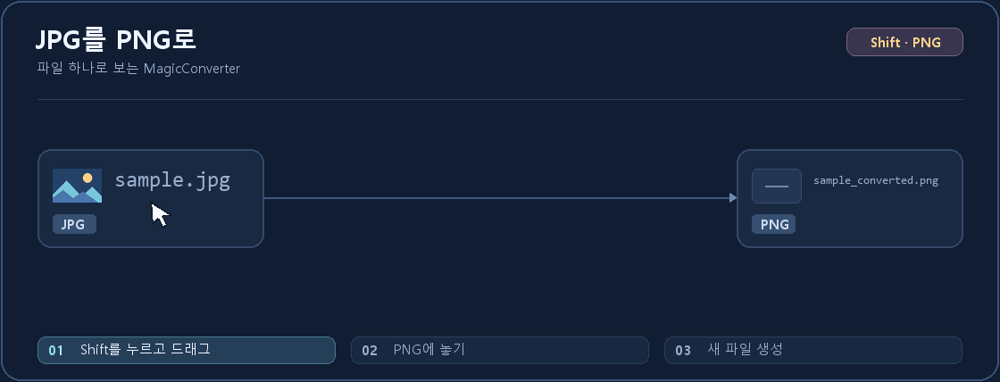

<h1 align="center">
  
</h1>

탐색기에서 파일을 끌어 문서, PDF, 이미지, 표와 미디어를 변환하는 Windows 앱입니다.

[EXE로 시작하기](#exe로-시작하기) · [CLI로 시작하기](#cli로-시작하기)

## EXE로 시작하기

[MagicConverter 2.2.30 설치 EXE](https://github.com/handaeho/MagicConverter/releases/download/v2.2.30/MagicConverter-Setup.exe)를 실행합니다. Windows 10·11 64비트용이며, 설치 마법사가 앱 전용 Python과 필수 라이브러리를 내려받아 설치합니다. 설치할 때 인터넷 연결이 필요합니다.

1. 설치 안내를 읽고 라이선스에 동의합니다.
2. 설치 폴더를 고르고 확인한 뒤 **설치**를 누릅니다.
3. 앱이 열리면 탐색기에서 파일을 드래그하고 <kbd>Shift</kbd>를 눌러 변환 형식을 선택합니다. <kbd>Ctrl</kbd>을 누르면 파일 도구 휠이 열립니다.

[2.2.30 설치 안내](https://github.com/handaeho/MagicConverter/blob/v2.2.30/docs/user/PUBLIC_WINDOWS.md) · [제거 EXE](https://github.com/handaeho/MagicConverter/releases/download/v2.2.30/Uninstall.exe) · [릴리스와 대응 소스](https://github.com/handaeho/MagicConverter/releases/tag/v2.2.30)

2.2.31은 Python·필수 라이브러리와 FFmpeg·FFprobe·rhwp를 내장한 설치 검증본입니다. [2.2.31 검증본 안내](docs/user/PUBLIC_WINDOWS.md)

<p align="center">
  
  <br><sub><a href="assets/readme/demo-still.png">정지 화면으로 보기</a></sub>
</p>

## CLI로 시작하기

PowerShell에서 선택한 설치 폴더를 열고 설치된 Python으로 `run_magic_converter.py`를 실행합니다.

```powershell
.\runtime\python.exe .\app\run_magic_converter.py --help
.\runtime\python.exe .\app\run_magic_converter.py convert --to png "C:\Files\sample.jpg" --output "C:\Files\out"
```

현재는 Python 파일을 실행하는 방식입니다. MCP 전환은 후속 버전에서 진행할 예정입니다.

프로젝트 코드와 [MagicConverter 아이콘](assets/README.md)은 [AGPL-3.0-or-later](LICENSE)로 공개합니다. [외부 구성요소 고지](docs/legal/THIRD_PARTY_NOTICES.md)
